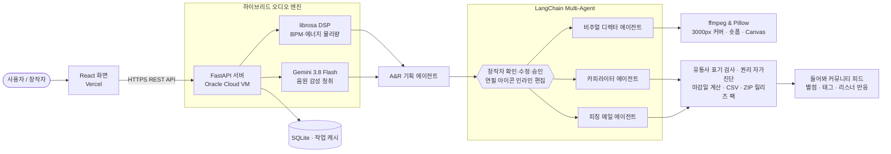

# 발매로 (Balmaero)

> **“음원 한 곡에서, 발매 가능한 릴리즈 팩까지.”**  
> **완성된 음원 한 곡을 분석해 발매에 필요한 기획·비주얼·메타데이터를 하나의 릴리즈 팩으로 만들어 주는 AI 발매 준비 플랫폼**

---

## 1. 프로젝트 소개 (Overview)

음악 창작자(인디 뮤지션, 학생, 1인 프로듀서)는 곡을 완성하고도 앨범 커버 디자인 외주 비용, A&R 기획서 부재, 유통사마다 상이한 메타데이터 규격 작성의 복잡함으로 인해 실제 발매 단계에서 심각한 병목을 겪습니다.

**"발매로(Balmaero)"**는 음원 파일(`.mp3`, `.wav`)을 업로드하면, **[librosa DSP 정량 분석 + Gemini 3.8 Flash 오디오 감성 청취]**의 2-Track 하이브리드 오디오 엔진으로 사운드를 파싱하고, **LangChain 기반 Multi-Agent 시스템 (에이전트 5종)**이 협업하여 발매에 필요한 **[A&R 콘셉트 기획서 + 고화질 앨범 아트워크 3종 + 숏폼(15초) & Spotify Canvas(8초) 영상 + 발매 규격 검사 시트(CSV) + 원클릭 ZIP 릴리즈 팩]**을 일괄 완성하는 웹 플랫폼입니다. 또한, 발매 전 동료 창작자들의 실시간 피드백을 확인할 수 있는 **'들어봐' 커뮤니티 공간**을 제공합니다.

---

## 2. 팀원 및 역할 분담 (Team R&R)

모든 팀원이 프로젝트에 실질적으로 기여하며 전문성을 발휘할 수 있도록 체계적으로 분업화되었습니다.

| 이름 | 포지션 | 세부 담당 업무 | 주요 산출물 |
| :---: | :--- | :--- | :--- |
| **팀장 (David)** | Product Lead & Frontend | • 발매로 서비스 기획 총괄 및 4단계 사용자 경험(UX) 설계<br>• React 프론트엔드 전체 UI 구현 및 모바일 반응형 최적화<br>• 발표 슬라이드(PPTX) 제작 및 프로젝트 릴리즈 관리 | React 프론트엔드 코드, UI 컴포넌트, 최종 발표 슬라이드 |
| **원일** | Tech Lead & AI / Backend | • 서버 전체(FastAPI 비동기 아키텍처, Oracle Cloud VM 배포, DB)<br>• librosa + Gemini 3.8 Flash 하이브리드 오디오 엔진 구축<br>• LangChain 에이전트 5종 및 gpt-image-2 / ffmpeg 영상 파이프라인<br>• 유통사 규격 검사 엔진, 권리 자가진단, '들어봐' 커뮤니티 개발 | FastAPI 백엔드 API, AI 멀티에이전트 파이프라인, 제출 문서 5종 |
| **이은희** | Service Policy & UX Research | • 서비스 이용약관 및 개인정보 수집·이용 동의서(v1.2~v1.6) 기획 및 법적 고지 조항 수립<br>• 커뮤니티 음원 권리 확인 조항 및 서비스 종료일(2026-10-31) 데이터 파기 규정 설계<br>• 사용자 피드백 수렴 및 UX 개선점 도출 (10/16 피드백 리포트) | 개인정보 수집이용 동의서(v1.6), 커뮤니티 운영 정책 문서, 개선안 리포트 |
| **신미영** | Industry Research & QA Testing | • 국내외 주요 음원 유통사(DistroKid, 뮤즈플랫폼) 규격 및 웹 콘솔 입력 항목 현황 조사<br>• 실제 음원 업로드 테스트 진행 및 기능 개선안 리포트 작성 (피드백 33건 도출)<br>• 유통사 반려 방지 가이드라인 및 플랫폼 메타데이터 검증 항목 수립 | 유통사 입력항목 조사 보고서, 실음원 테스트 결과 및 개선안 리포트 |
| **이지은** | Audio Dataset & Usability Evaluation | • 다양한 장르별(인디팝, 어쿠스틱, 힙합, 록 등) 테스트용 음원 데이터 수집 및 메타데이터 정비<br>• 배포 서비스 실사용자 테스트 진행 및 설문 데이터 수렴 지원<br>• A&R 리포트 감성 분석 일치도 검증 및 홍보 카피 사용성 평가 | 테스트 음원 데이터셋, 사용자 만족도 설문 집계 데이터 |
---

## 3. 기술 스택 (Tech Stack)

| 영역 | 사용 기술 |
| :--- | :--- |
| **AI · 멀티모달** | **Google Gemini 3.8 Flash** (음원 청각 감성 분석, 3.7 ➔ 3.6 ➔ 3.5 Fallback 체인)<br>코디세이 API: **gpt-image-2** (커버 아트워크 생성), **gpt-5.4 / gpt-5.4-mini** (A&R 및 카피라이팅) |
| **Agent Framework** | **LangChain** — A&R 기획, 비주얼 디렉터, 카피라이터, 피칭, 에디토리얼 에이전트 (총 5종) |
| **Audio & Media** | Python `librosa`, `soundfile`, `ffmpeg`, `Pillow`, `Chromaprint` (소리 지문) |
| **Frontend** | React, Vite, Tailwind CSS, Web Audio API, Lucide Icons |
| **Backend** | Python 3.12, FastAPI, Uvicorn, Pydantic, SQLite |
| **Infra & DevOps** | **Oracle Cloud VM** (백엔드 API: `api.201.n-e.kr`, Caddy HTTPS, systemd)<br>**Vercel** (프론트엔드 CDN 배포) |
| **Auth & Security** | 카카오 · 구글 OAuth 2.0 (로그인 없이도 이용 가능한 체험 모드 지원) |

### 📌 필수 기술 요건 충족 내역
1. **AI Agent**: LangChain 기반 에이전트 5종 협업 + 창작자가 직접 검토하고 수정·승인하는 인라인 인터페이스(Human-in-the-loop)
2. **멀티모달 AI**: 음원 파일(`.mp3`, `.wav`)을 직접 듣고 해석하는 청각 멀티모달(Gemini) ➔ 텍스트(A&R) ➔ 이미지(커버) ➔ 비디오(숏폼/Canvas) 생성 파이프라인
3. **자동화 워크플로우**: 음원 업로드 ➔ DSP 물리량 파싱 ➔ AI 감성 청취 ➔ 멀티에이전트 병렬 생성 ➔ ffmpeg 렌더링 ➔ 유통사 규격 자동 검사 및 ZIP 패키징

---

## 4. 시스템 아키텍처 (System Architecture)



상세 아키텍처 명세: [`docs/제출/02_시스템아키텍처.md`](docs/제출/02_시스템아키텍처.md)

---

## 5. 핵심 AI 활용 및 워크플로우

### ① 하이브리드 오디오 분석 (DSP + Gemini 3.8 Flash)
* **librosa DSP**: BPM(템포), 비트 그리드, Spectral Centroid(음색 밝기), RMS Energy(사운드 에너지) 정량 측정
* **Gemini 3.8 Flash**: 오디오를 직접 청취하여 보컬 특성, 장르, 사용 악기, 무드, 감정선을 문맥적으로 해석
* **설계 원칙**: AI 분석 결과는 '확정'이 아닌 사용자가 언제든 수정할 수 있는 **'초안(Draft)'**으로 제공

### ② 협업형 Multi-Agent 파이프라인
* **A&R 에이전트**: 사운드 프로파일을 기반으로 앨범 타이틀, 콘셉트 문구, 타겟 리스너 프로파일링
* **비주얼 디렉터**: 승인된 콘셉트를 이미지 프롬프트로 변환하여 커버 아트 3종 생성 및 숏폼/Canvas 영상 프레임 구성
* **카피라이터 & 피칭**: SNS 채널별 홍보 문구 및 유통사·웹진 피칭 메일 자동 작성
* **프롬프트 격리**: 단일 프롬프트 대비 프롬프트 오염을 방지하고 JSON 스키마 검증기로 안정성 확보

### ③ 4단계 사용자 워크플로우 (Step 1~4)
* **Step 1 (음원 업로드)**: 오디오 파형 시각화, 파일 파싱, 예시곡 체험 모드 지원
* **Step 2 (A&R 리포트)**: 30초 내 초안 생성, 연필 아이콘을 통한 인라인 편집 및 수락
* **Step 3 (비주얼 선택)**: gpt-image-2 커버 아트 선택, 3000px 업스케일, ffmpeg 숏폼 영상 생성
* **Step 4 (릴리즈 팩 & '들어봐')**: 유통사별 등록 마감일 자동 계산, 제출 준비표(CSV), ZIP 다운로드, '들어봐' 커뮤니티 공개

---

## 6. 실행 방법 (Getting Started)

### 로컬 백엔드 실행 (Docker)
```bash
cd backend
cp .env.example .env      # 코디세이·Gemini API 키 및 CORS 설정
docker compose up --build
```
API 문서(Swagger): `http://localhost:8000/docs`

### 로컬 백엔드 실행 (Python 직접 실행)
```bash
cd backend
# Windows:
python -m venv venv
venv\Scripts\activate
# Mac/Linux:
# source venv/bin/activate

pip install -r requirements.txt       # ffmpeg 별도 설치 필요
uvicorn app.main:app --reload --port 8000
```

### 로컬 프론트엔드 실행
```bash
cd frontend
npm ci
npm run dev
```
브라우저 접속: `http://localhost:5173` (또는 `http://localhost:3000`)

---

## 7. 실사용자 테스트 결과 및 개선 (Validation)

10월 16일부터 19일까지 배포된 실제 서비스를 통해 사용자 테스트 및 피드백을 수집·반영했습니다.

* **전체 사용자 모수**: **서버 기록 기준 35명 사용 · 설문 10건** (발매 준비 19명, '들어봐' 반응 참여 16명)
* **핵심 지표**:
  * **업로드 ➔ A&R 노트 완성 시간**: 중앙값 **30초** (0.5분, 실패율 0%)
  * **노트를 직접 수정한 작업 비율**: **71% (5/7건)** ➔ *"AI가 먼저 듣고 사람이 고친다"*는 협업 설계 검증 완료
  * **만족도 지표**: 전반 만족도, 재사용 의향, AI 해석 정확도 모두 **4.67 / 5.0** (설문 응답 3명의 평균)
  * **홍보글 평가**: 설문 응답자 3명 전원 **"그대로 쓸 수 있다"** 응답
* **피드백 기반 주요 개선 내역**:
  1. **커버 생성 시간 단축**: 후보 6장 ➔ 3장 최적화 및 API 키 로테이션 적용 ➔ **체험 작업 실측 81초**로 단축
  2. **이탈 방지 UX 개편**: 노트를 받고 수락하기 전 멈추던 현상 해결을 위해 수정 안내, 연필 아이콘, 버전 안내 추가
  3. **예시곡 체험 모드**: 음원 파일이 없는 사용자도 즉시 전 과정을 둘러볼 수 있는 체험 모드 신설
  4. **모바일 가독성 및 세션 안정화**: 모바일 좁은 화면 텍스트 오버플로우 개선 및 OAuth 세션 유지 조치

상세 테스트 리포트: [`docs/제출/04_사용자테스트_결과.md`](docs/제출/04_사용자테스트_결과.md)

---

## 8. 라이선스 및 AI 윤리 규정 (AI Ethics)

* **AI 생성물 투명성 명시**: 서비스에서 생성된 모든 앨범 커버 및 텍스트 메타데이터에 'AI Generated'가 명기됩니다.
* **음원 'AI 활용 여부' 표시**: 사용자가 유통사 제출 시 AI 활용 여부를 명확히 선택·고지할 수 있도록 지원합니다.
* **저작권 보호 및 도용 차단**: Chromaprint 오디오 핑거프린트(소리 지문) 기술을 통해 타인의 음원 무단 도용 및 중복 업로드를 방지합니다.
* **개인정보 보호 및 데이터 파기**: 서비스 이용 동의서 v1.6에 의거하여, 프로젝트 평가 종료 후 **2026년 10월 31일 테스트 음원 및 사용자 데이터를 일괄 영구 파기**합니다.

---

## 9. 관련 문서 및 링크

| 구분 | 링크 및 경로 |
| :--- | :--- |
| **배포 서비스 (Frontend)** | [Vercel 배포 URL](https://codyssey-m2-1.vercel.app) *(실제 서비스 접속 가능)* |
| **백엔드 API 서버** | [https://api.201.n-e.kr](https://api.201.n-e.kr) *(Oracle Cloud VM)* |
| **발표 슬라이드 (PPTX)** | [`/balmaero_presentation.pptx`](balmaero_presentation.pptx) |
| **기능 요구 명세서 (FR/NFR)** | [`docs/제출/01_기능요구명세서.md`](docs/제출/01_기능요구명세서.md) |
| **시스템 아키텍처 명세** | [`docs/제출/02_시스템아키텍처.md`](docs/제출/02_시스템아키텍처.md) |
| **기술 스택 선정 이유** | [`docs/제출/03_기술스택_선정이유.md`](docs/제출/03_기술스택_선정이유.md) |
| **사용자 테스트 결과 보고서** | [`docs/제출/04_사용자테스트_결과.md`](docs/제출/04_사용자테스트_결과.md) |
| **시연 영상** | [Google Drive 영상 바로가기](여기에_구글_드라이브_공유_링크를_붙여넣어주세요) · [상세 타임라인](docs/제출/00_시연영상.md) |
