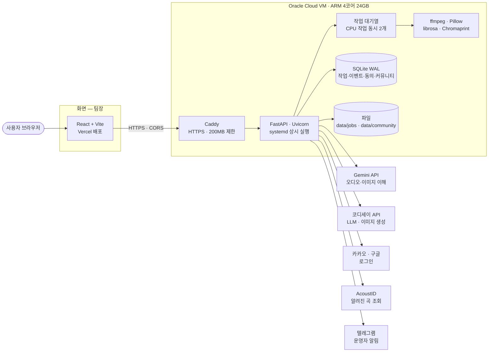
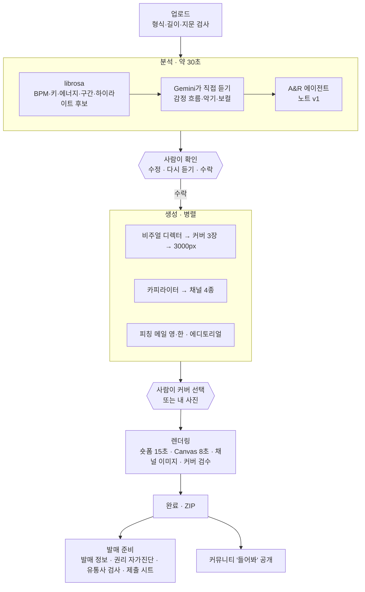

# 발매로 — 시스템 아키텍처

> 작성: 백엔드(원일) 초안 · 2026-10-19 · 기준: 실서버 `api.201.n-e.kr`

## 1. 전체 구성



- 서버는 한 대: API·분석·영상 처리·파일·DB가 같은 VM에 있어 결과물을 서버 사이에서 옮기지 않는다.
- 외부 AI는 두 곳뿐: **Gemini**(곡 듣기, 커버 검수), **코디세이 API**(글 쓰기 에이전트, 커버 이미지).

## 2. 작업 흐름 (파이프라인)



작업 단계: `uploaded → analyzing → note_ready → generating → awaiting_cover → rendering → done` (어느 단계든 실패하면 `failed`, 그 단계부터 다시 시도)

- **단계마다 저장**: 결과는 `data/jobs/<job_id>/` 파일과 DB 상태로 남고, 서버가 다시 켜지면 하던 작업을 복구한다.
- **사람이 결정하는 곳 두 군데**: 노트 수락, 커버 선택. 그 전에는 비싼 생성을 시작하지 않는다.
- **숏폼은 커버를 고른 뒤에만** 만든다(3종을 미리 렌더링하지 않음).

## 3. 백엔드 코드 구조

```
backend/app/
  main.py          FastAPI 앱, CORS, 보안 헤더, 브라우저 익명 ID
  api/             라우터 — 작업·노트·결과·발매 준비·커뮤니티·로그인·설문·운영자 (엔드포인트 약 68개)
  schemas/         요청·응답 모델 (API 계약은 여기에만)
  pipeline/        단계 실행기 — 분석·생성·렌더링·유통사 검사·권리·커뮤니티·지문·금칙어·보관 삭제
  agents/          LangChain 에이전트 — A&R·비주얼·카피·피칭·에디토리얼·커버 고르기·커버 검수·시간 표기 검사
  adapters/        외부 API — gemini, codyssey_llm, codyssey_image, 키 로테이션, 재시도
  analysis/        librosa 특징·파형·하이라이트
  prompts/*.md     프롬프트 (코드와 분리)
  templates/*.yaml 숏폼·채널 이미지 배치
  core/            설정(.env), 단계 이름, 오류 형식
backend/scripts/   cleanup(보관 삭제, 매일), usage_report(테스트 요약), make_demo(체험 곡) 등
```

## 4. 데이터와 보관

| 데이터 | 저장 위치 | 보관 |
| --- | --- | --- |
| 원본 음원(WAV는 FLAC으로), 분석 결과, 노트 버전, 커버·영상·글 | `data/jobs/<job_id>/` | 서비스 종료일(2026-10-31) 일괄 삭제 |
| 공개 곡 음원·커버 (하이라이트만 공개면 15초만) | `data/community/<track_id>/` | 올린 사람이 내리거나 종료일 |
| 작업 상태·이벤트·동의 기록 | SQLite `jobs`, `events`, `consents` | 종료일 |
| 반응·신고 | SQLite `feedback`, `reports` | 종료일 (접속 IP는 7일) |
| 계정(닉네임·고유 식별값)·세션 | SQLite `users`, `sessions` | 탈퇴 즉시 / 종료일 |
| 소리 지문 | SQLite `track_fingerprints` | 곡을 내리면 같이 / 종료일 |

`scripts/cleanup.py`가 매일 돌며 지운다. 운영자는 종료 전에 `/admin`에서 CSV를 받아 둔다.

## 5. 보안·남용 방지

- **전송**: Caddy HTTPS, CORS는 등록한 화면 주소만, 로그인은 Bearer 토큰(다른 주소 화면) 또는 쿠키(같은 주소)
- **권한**: 작업 ID는 추측할 수 없는 ULID, 다운로드는 만료 토큰, 공개 곡 관리는 서명한 관리 키, 운영자 페이지는 별도 키 + 틀리면 잠금
- **입력**: 파일 앞부분으로 진짜 음원인지 확인, ffmpeg 형식 고정·시간 제한, 이미지·글 길이 제한, 화면 출력 XSS 방지
- **남용**: 1회용 제출 토큰, 반응 간격·분당 상한·차단, 금칙어·광고·도배 검사, 신고 누적 자동 숨김 + 텔레그램 알림, 하루 생성·공개·신고 한도
- **남의 곡**: 업로드 직후 Chromaprint 지문으로 공개 곡과 비교, AcoustID로 알려진 곡 조회

## 6. 배포

| 구분 | 방식 |
| --- | --- |
| 백엔드 | Oracle Cloud ARM VM, Python venv + systemd `--user` 서비스, Caddy 리버스 프록시 |
| 배포 절차 | 커밋된 코드만 `git archive`로 서버에 보내고 서비스 재시작 → `/health` 확인 (`scripts/deploy_indie.sh`) |
| 화면 | Vercel (팀장) |
| 개발 | Docker Compose (서버와 같은 라이브러리 버전) |
| 비밀값 | 서버 `.env`에만 (API 키·로그인 키·운영자 키). 저장소에 없음 |
