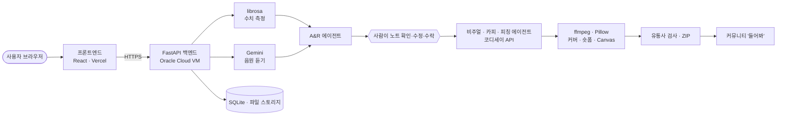

# 발매로 — 백엔드 아키텍처 및 로컬 실행 명세

> 발매로(Balmaero) 백엔드 코어 사양, AI 멀티에이전트 파이프라인, 로컬 실행 가이드 및 연동 명세서

---

## 1. 기술 스택 (Tech Stack)

| 영역 | 사용 기술 |
| --- | --- |
| AI · 멀티모달 | Gemini 3.8 Flash (음원 직접 듣기), 코디세이 API — gpt-5.4 / gpt-5.4-mini (글), gpt-image-2 (커버) |
| AI Agent | LangChain — A&R · 비주얼 디렉터 · 카피라이터 · 피칭 · 에디토리얼 에이전트 |
| 오디오 · 영상 | librosa, ffmpeg, Pillow, Chromaprint |
| 백엔드 | Python 3.12, FastAPI, Uvicorn, Pydantic, SQLite |
| 프론트엔드 | React 18, Vite, Tailwind CSS, Lucide Icons |
| 배포 | Oracle Cloud (백엔드, Caddy HTTPS, systemd), Vercel (프론트엔드) |
| 로그인 | 카카오 · 구글 OAuth 2.0 |

**필수 기술 요소**:
1. **AI Agent**: LangChain 기반 에이전트 5종 + 창작자가 직접 확인하고 수정·승인하는 인라인 인터페이스(Human-in-the-loop)
2. **멀티모달**: 음원(오디오) 직접 청취 ➔ 해석 텍스트(A&R) ➔ 이미지(커버) ➔ 비디오(숏폼/Canvas) 생성 파이프라인
3. **자동화 워크플로우**: 업로드 ➔ 분석 ➔ 생성 ➔ 렌더링 ➔ 규격 검사, 실패 단계부터 재시도, 매일 보관 삭제 스케줄러

---

## 2. 시스템 아키텍처 (System Architecture)



상세 아키텍처 구성: [`docs/제출/02_시스템아키텍처.md`](docs/제출/02_시스템아키텍처.md)

---

## 3. 실행 방법 (Getting Started)

### 백엔드 실행 (Docker)
```bash
cd backend
cp .env.example .env      # API 키 및 환경 변수 설정
docker compose up --build
```
API 대화형 문서: `http://localhost:8000/docs`

### 백엔드 실행 (Python 가상환경)
```bash
cd backend
python -m venv venv && source venv/bin/activate   # Windows: venv\Scripts\activate
pip install -r requirements.txt                   # ffmpeg 별도 설치 필요
uvicorn app.main:app --reload --port 8000
```

### 프론트엔드 실행
```bash
cd frontend
npm ci
npm run dev
```

---

## 4. 서비스 링크 (Endpoints)

| 구분 | 주소 |
| --- | --- |
| 프론트엔드 웹 서비스 | https://codyssey-m2-1.vercel.app |
| 백엔드 API 서버 | https://api.201.n-e.kr |
| 백엔드 Swagger 문서 | https://api.201.n-e.kr/docs |
| 시연 영상 (Google Drive) | [시연 영상 안내 및 링크](docs/제출/00_시연영상.md) |
| GitHub 저장소 | https://github.com/davidchoi0507/Codyssey_M2-1 |

---

## 5. 관련 제출 문서 (Deliverables)

- 서비스 시연 영상 안내 — [docs/제출/00_시연영상.md](docs/제출/00_시연영상.md)
- 기능 요구 명세서 (FR/NFR) — [`docs/제출/01_기능요구명세서.md`](docs/제출/01_기능요구명세서.md)
- 시스템 아키텍처 명세서 — [`docs/제출/02_시스템아키텍처.md`](docs/제출/02_시스템아키텍처.md)
- 기술 스택 및 의사결정 기록 (ADR) — [`docs/제출/03_기술스택_선정이유.md`](docs/제출/03_기술스택_선정이유.md)
- 실사용자 테스트 결과 보고서 — [`docs/제출/04_사용자테스트_결과.md`](docs/제출/04_사용자테스트_결과.md)

---

## 6. 팀원 역할 분담 (Team R&R)

| 이름 | 포지션 | 세부 담당 업무 |
| :---: | :--- | :--- |
| **팀장 (David)** | Product Lead & Frontend | • 발매로 서비스 기획 총괄 및 4단계 사용자 경험(UX) 설계<br>• React 프론트엔드 전체 UI 구현 및 모바일 반응형 최적화<br>• 발표 슬라이드(PPTX) 제작 및 프로젝트 릴리즈 관리 |
| **이원일** | Tech Lead & AI / Backend | • 서버 전체(FastAPI 비동기 아키텍처, Oracle Cloud VM 배포, DB)<br>• librosa + Gemini 3.8 Flash 하이브리드 오디오 엔진 구축<br>• LangChain 에이전트 5종 및 gpt-image-2 / ffmpeg 영상 파이프라인<br>• 유통사 규격 검사 엔진, 권리 자가진단, '들어봐' 커뮤니티 개발 |
| **이은희** | Service Policy & UX Research | • 서비스 이용약관 및 개인정보 수집·이용 동의서(v1.2~v1.6) 기획 및 법적 고지 조항 수립<br>• 커뮤니티 음원 권리 확인 조항 및 서비스 종료일(2026-10-31) 데이터 파기 규정 설계<br>• 사용자 피드백 수렴 및 UX 개선점 도출 (10/16 피드백 리포트) |
| **신미영** | Industry Research & QA Testing | • 국내외 주요 음원 유통사(DistroKid, 뮤즈플랫폼) 규격 및 웹 콘솔 입력 항목 현황 조사<br>• 실제 음원 업로드 테스트 진행 및 기능 개선안 리포트 작성 (10/16 팀 피드백(10건) + 개선안 리포트(8건))<br>• 유통사 반려 방지 가이드라인 및 플랫폼 메타데이터 검증 항목 수립 |
| **김지은** | Audio Dataset & Usability Evaluation | • 다양한 장르별(인디팝, 어쿠스틱, 힙합, 록 등) 테스트용 음원 데이터 수집 및 메타데이터 정비<br>• 배포 서비스 실사용자 테스트 진행 및 설문 데이터 수렴 지원<br>• A&R 리포트 감성 분석 일치도 검증 및 홍보 카피 사용성 평가 |