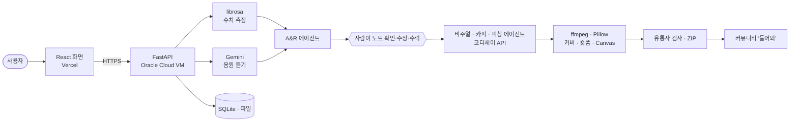

# README에 넣을 백엔드 부분 (초안)

> 팀장님이 최종 README.md에 붙여 넣을 수 있게 섹션별로 정리했어요. 지금 저장소 루트 README는 예전 기획(DALL-E 3·Render·LangGraph·Resend 이메일·비주얼라이저) 기준이라 아래 내용으로 바꿔야 해요.
> 고칠 곳: 기술 스택, 시스템 아키텍처, 실행 방법, 팀원 역할의 백엔드 칸.

---

## 기술 스택

| 영역 | 사용 기술 |
| --- | --- |
| AI · 멀티모달 | Gemini 3.8 Flash (음원 직접 듣기), 코디세이 API — gpt-5.4 / gpt-5.4-mini (글), gpt-image-2 (커버) |
| AI Agent | LangChain — A&R · 비주얼 디렉터 · 카피라이터 · 피칭 · 에디토리얼 에이전트 |
| 오디오 · 영상 | librosa, ffmpeg, Pillow, Chromaprint |
| 백엔드 | Python 3.12, FastAPI, Uvicorn, Pydantic, SQLite |
| 프론트엔드 | React, Vite, Tailwind CSS |
| 배포 | Oracle Cloud (백엔드, Caddy HTTPS, systemd), Vercel (프론트엔드) |
| 로그인 | 카카오 · 구글 OAuth |

**필수 기술 요소**: ① AI Agent(LangChain 에이전트 5종 + 사람이 확인하는 단계) ② 멀티모달(음원 → 해석 글 · 이미지 · 영상, 이미지 → 검수) ③ 자동화 워크플로우(업로드 → 분석 → 생성 → 렌더링 → 검사, 실패 단계부터 재시도, 매일 보관 삭제, 신고 알림)

## 시스템 아키텍처



자세한 구성: [`docs/제출/02_시스템아키텍처.md`](https://github.com/davidchoi0507/Codyssey_M2-1/blob/woniri/docs/%EC%A0%9C%EC%B6%9C/02_%EC%8B%9C%EC%8A%A4%ED%85%9C%EC%95%84%ED%82%A4%ED%85%8D%EC%B2%98.md)

## 실행 방법

### 백엔드 (Docker)
```bash
cd backend
cp .env.example .env      # 코디세이·Gemini 키, CORS 주소 입력
docker compose up --build
```
API 문서: `http://localhost:8000/docs`

### 백엔드 (Python 직접)
```bash
cd backend
python -m venv venv && source venv/bin/activate   # Windows: venv\Scripts\activate
pip install -r requirements.txt                   # ffmpeg 별도 설치 필요
uvicorn app.main:app --reload --port 8000
```

### 프론트엔드
```bash
cd frontend
npm ci
npm run dev
```

## 링크

| 구분 | 주소 |
| --- | --- |
| 서비스 | https://codyssey-m2-1.vercel.app |
| 백엔드 API | https://api.201.n-e.kr |
| 시연 영상 | (링크) |

## 문서

- 기능 요구 명세서 — [`docs/제출/01_기능요구명세서.md`](https://github.com/davidchoi0507/Codyssey_M2-1/blob/woniri/docs/%EC%A0%9C%EC%B6%9C/01_%EA%B8%B0%EB%8A%A5%EC%9A%94%EA%B5%AC%EB%AA%85%EC%84%B8%EC%84%9C.md)
- 시스템 아키텍처 — [`docs/제출/02_시스템아키텍처.md`](https://github.com/davidchoi0507/Codyssey_M2-1/blob/woniri/docs/%EC%A0%9C%EC%B6%9C/02_%EC%8B%9C%EC%8A%A4%ED%85%9C%EC%95%84%ED%82%A4%ED%85%8D%EC%B2%98.md)
- 기술 스택 선정 이유 — [`docs/제출/03_기술스택_선정이유.md`](https://github.com/davidchoi0507/Codyssey_M2-1/blob/woniri/docs/%EC%A0%9C%EC%B6%9C/03_%EA%B8%B0%EC%88%A0%EC%8A%A4%ED%83%9D_%EC%84%A0%EC%A0%95%EC%9D%B4%EC%9C%A0.md)
- 사용자 테스트 결과 — [`docs/제출/04_사용자테스트_결과.md`](https://github.com/davidchoi0507/Codyssey_M2-1/blob/woniri/docs/%EC%A0%9C%EC%B6%9C/04_%EC%82%AC%EC%9A%A9%EC%9E%90%ED%85%8C%EC%8A%A4%ED%8A%B8_%EA%B2%B0%EA%B3%BC.md)

## 팀원 역할 — 백엔드 칸

| 이름 | 역할 | 담당 |
| --- | --- | --- |
| 원일 | 백엔드 · AI | 서버 전체(FastAPI·배포·DB), librosa + Gemini 분석, LangChain 에이전트, 커버·숏폼·Canvas 생성, 유통사 검사·권리 자가진단, 커뮤니티·로그인·신고·남의 곡 감지, 사용 기록·설문·운영자 페이지 |
